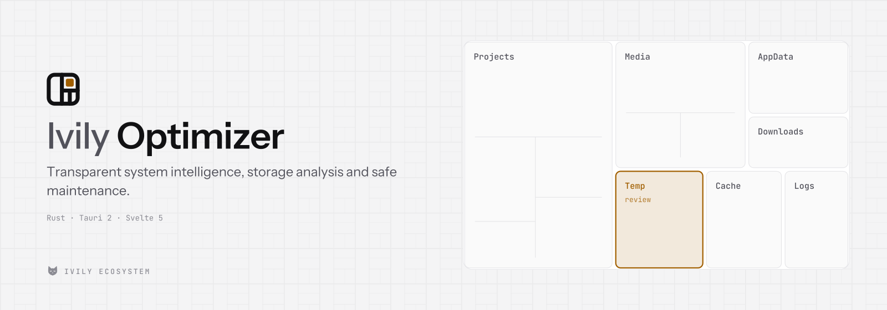
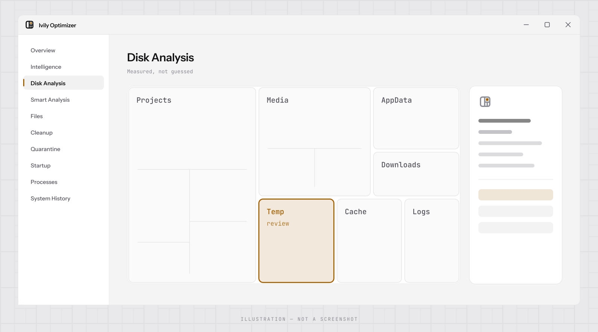
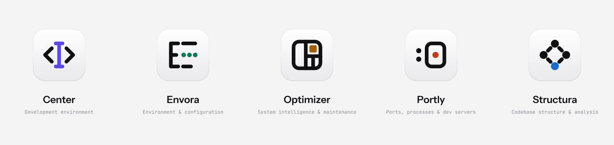

<p align="center">
  <picture>
    <source media="(prefers-color-scheme: dark)" srcset="assets/brand/banners/ivily-optimizer-readme-banner-dark.svg">
    
  </picture>
</p>

<p align="center">
  <b>Türkçe</b> · <a href="README.en.md">English</a>
  &nbsp;|&nbsp;
  <a href="https://github.com/efecrtgl/ivily-optimizer/releases/latest">İndir</a> ·
  <a href="docs/OZELLIKLER.md">Özellikler</a> ·
  <a href="docs/TEMIZLIK-GUVENLIGI.md">Temizlik güvenliği</a> ·
  <a href="ROADMAP.md">Yol haritası</a>
</p>

<p align="center">
  <a href="https://github.com/efecrtgl/ivily-optimizer/actions/workflows/ci.yml"></a>
  <a href="https://github.com/efecrtgl/ivily-optimizer/releases/latest"></a>
  <a href="LICENSE"></a>
</p>

**Ivily Optimizer**; bilgisayarınızda neyin yer kapladığını, hangi klasörlerin büyüdüğünü, arka planda nelerin çalıştığını, Windows'un olay günlüklerinde neler kaydedildiğini ve neyin güvenle temizlenebileceğini **gerçek verilere dayanarak** anlamanıza yardımcı olan yerel, gizlilik odaklı bir Windows uygulamasıdır.

Modüller birbirine bağlıdır: bir sorun **ölçülür**, Ivily Zekâsı kanıtı ve yorumu **ayrı ayrı açıklar**, ilgili eylem **önerilir**, yapılan işlem **kaydedilir** ve mümkünse **geri alınabilir**.

> [!IMPORTANT]
> **Sıradan bir "PC temizleyici" değildir.** Abartılı performans vaatlerinde bulunmaz. RAM "temizleme", kayıt defteri temizliği, toplu servis kapatma ve sahte ölçümler bilerek **yoktur**.

> [!NOTE]
> **Durum:** Yayımlanan son sürüm **[0.2.0](https://github.com/efecrtgl/ivily-optimizer/releases/tag/v0.2.0)**. `main` dalı **0.3.0** geliştirme sürümüdür (henüz yayımlanmadı): güvenlik sertleştirmesi, veri kurtarma, büyük ölçüde azaltılmış boşta işlemci kullanımı, Türkçe/İngilizce dil altyapısı ve Ivily ekosistemi hazırlığı. Ayrıntılar: [CHANGELOG.md](CHANGELOG.md), [ROADMAP.md](ROADMAP.md), [docs/DENETIM.md](docs/DENETIM.md).

<p align="center">
  <picture>
    <source media="(prefers-color-scheme: dark)" srcset="assets/brand/illustrations/ivily-optimizer-product-visual-dark.svg">
    
  </picture>
  <br><sub><i>Çizimdir, ekran görüntüsü değildir. Gerçek ekran görüntüleri <code>assets/screenshots/</code> klasörüne eklenecektir; o zamana kadar uygulamanın görünümü için <a href="docs/TASARIM-SISTEMI.md">docs/TASARIM-SISTEMI.md</a> belgesine bakın.</i></sub>
</p>

## Özellikler

| Alan | Neler yapar |
|---|---|
| **Genel Bakış** | Sıfırdan tasarlanmış modüler pano: karşılama, hızlı eylemler, Ivily önerileri, donanım, canlı CPU/RAM/ağ, diskler, depolama, sistem olayları, bildirim merkezi, son işlemler, güncelleme. Bileşenler sıralanabilir, genişletilebilir ve gizlenebilir. |
| **Ivily Zekâsı** | Diskler, tarama içgörüleri, temizlik, olay günlüğü, başlangıç öğeleri, karantina ve güncellemelerden kanıta dayalı öneriler; ölçülen veri ve yorum ayrı gösterilir. |
| **Disk Analizi** | Paralel ve iptal edilebilir tarama, treemap, klasör gezgini, dosya türü dağılımı, erişim sorunları, anlık görüntüler. |
| **Akıllı Analiz** | Depolama içgörüleri (kullanıcı klasörleri, uygulama depolaması, geçici/önbellek klasörleri, darboğazlar), küçük dosya yoğunluğu, hızlı büyüyen klasörler. |
| **Dosya Yönetimi** | Gelişmiş gezgin (meta veri, imza, SHA-256/BLAKE3 özet, envanter), büyük/eski/yinelenen dosyalar, boş klasörler, klasör karşılaştırma. |
| **Temizlik** | Risk sınıflı kategoriler, dosya düzeyinde önizleme, onay, iptal, gerçek sonuç raporu, karantina modu, özel kurallar. |
| **Karantina** | Geri alınabilir taşıma, doğrulanan ve asla üzerine yazmayan geri yükleme. |
| **Başlangıç** | Kayıt defteri ve klasör öğeleri, Authenticode imza durumu, inceleme notları, başlangıç görevleri, otomatik servisler, açılış performansı kayıtları. |
| **İşlemler** | Ağaç görünümü, bağlantı sayısı, ayrıntılar (komut satırı, üst/alt süreçler, imza, ağ bağlantıları), korumalı sonlandırma ve güvenli yeniden başlatma. |
| **Servisler ve Görevler** | Servis bağımlılıkları, başlat/durdur/yeniden başlat, başlangıç türü; görev ayrıntıları ve çalışma geçmişi. Kritik bileşenler korunur. |
| **Sistem Geçmişi** | Windows olay günlükleri: kategoriler, zaman çizelgesi, tekrarlayan sorunlar, olay bağlamı, TXT/CSV/JSON rapor. |
| **İşlem Geçmişi** | Önceki/yeni durum, onay ve geri alma durumu; arama, dışa aktarma, arka uçta doğrulanan geri alma. |
| **Performans ve Ağ** | Canlı geçmiş grafikleri, güç planları, bağdaştırıcılar, bağlantı testi, DNS araçları. |
| **Güncellemeler** | GitHub Releases, kararlı/ön sürüm kanalı, imza doğrulamalı aşamalı kurulum. |
| **Tasarım** | Tek renkli cam tasarım sistemi, koyu/açık/sistem tema. |
| **Dil** | Türkçe (birincil). İngilizce: gezinme, ortak bileşenler, tarih/sayı biçimleri ve güncelleme durumları; sayfa içerikleri henüz Türkçe. |

## Güvenlik felsefesi

- Hiçbir şey onayınız olmadan silinmez veya değiştirilmez. Her temizlikten önce ayrıntılı önizleme gösterilir.
- Bilinmeyen dosyalar asla "Güvenli" olarak sınıflandırılmaz; "İncelenmeli" öğeler varsayılan olarak seçilmez.
- Mümkün olduğunda geri alınabilir yöntemler kullanılır: karantina, Geri Dönüşüm Kutusu, başlangıç öğesini silmeden devre dışı bırakma.
- Windows klasörü, Program Files, sistem önyükleme dosyaları ve benzeri korunan konumlara dokunulmaz ([docs/TEMIZLIK-GUVENLIGI.md](docs/TEMIZLIK-GUVENLIGI.md)).
- Uygulamanın tamamı yönetici olarak çalışmaz; yönetici hakkı gereken tek bir işlem için yalnızca o komut için Windows onayı (UAC) istenir.
- Arayüzden gelen her yol yerel bir sürücü yolu olarak doğrulanır; ağ yolları, `..` bölümleri ve junction ile korunan konumlara ulaşma girişimleri reddedilir. Kullanıcı tanımlı temizlik kuralları hiçbir zaman kalıcı silme yapmaz, her zaman karantinaya taşır.
- Arayüze yalnızca iki Tauri yeteneği verilir (`core:default`, klasör seçme penceresi). Ayrıntılar: [SECURITY.md](SECURITY.md).

## Gizlilik

- Hesap, telemetri, reklam veya izleme yoktur.
- Tarama sonuçları, dosya yolları, anlık görüntüler ve günlükler bilgisayarınızdan çıkmaz.
- İnternet yalnızca güncelleme denetimi ve sizin başlattığınız ağ tanılama testleri için kullanılır.
- Tüm veriler `%LOCALAPPDATA%\IvilyOptimizer` altında tutulur ve Ayarlar > Gizlilik bölümünden dışa aktarılabilir veya silinebilir.

## Performans

Arka plan servisi yoktur; canlı izleme yalnızca ilgili sayfa açıkken çalışır, pencere simge durumundayken yoklama ve animasyonlar durur. Ölçülen boşta işlemci kullanımı 0.2.0'a göre görünür pencerede **%74**, simge durumunda **%98** daha düşüktür. Yöntem ve sayılar: [docs/PERFORMANS.md](docs/PERFORMANS.md).

## Kurulum

[GitHub Releases](https://github.com/efecrtgl/ivily-optimizer/releases/latest) sayfasından `Ivily Optimizer_x.y.z_x64-setup.exe` dosyasını indirip çalıştırın. Kurmadan denemek için `…_tasinabilir.zip` dosyasını da kullanabilirsiniz. Kurulum yönetici hakkı gerektirmez ve yalnızca kullanıcı hesabınıza yapılır. Ayrıntılar: [docs/KURULUM.md](docs/KURULUM.md).

**Sistem gereksinimleri:** Windows 10 (1803 veya üzeri) ya da Windows 11, 64 bit (geliştirme ve ölçümler Windows 11 üzerinde yapılmıştır) · Microsoft Edge WebView2 Çalışma Zamanı (Windows 11'de hazır gelir; yoksa kurulum sırasında otomatik indirilir) · yaklaşık 30 MB disk alanı.

## Kullanım

1. **Disk Analizi** sayfasında bir sürücü seçip taramayı başlatın. Sonuçlar Akıllı Analiz ve Dosya Yönetimi sayfalarında da kullanılır.
2. **Temizlik** sayfasında taramayı başlatın, öğeleri ve açıklamalarını inceleyin, önizlemeyi onaylayın.
3. Büyüme takibi için aynı konumu zaman içinde yeniden tarayın; **Akıllı Analiz > Hızlı büyüyen klasörler** ve **Geçmiş > Anlık görüntüler** karşılaştırma sunar.

Ayrıntılı özellik açıklamaları: [docs/OZELLIKLER.md](docs/OZELLIKLER.md).

## Mimari

```
Svelte 5 arayüzü (düz JavaScript)   pages · lib/components · lib/state · Ivily Zekâsı · api.js
            │  invoke / olaylar
Rust çekirdeği (Tauri 2)            commands → scan · files · cleanup · quarantine · snapshots ·
                                    oplog · sysmgmt (startup, services, tasks, events, signature…)
                                    · monitor · jobs · db · ecosystem (IEP)
```

Arayüz Svelte 5 ile **düz JavaScript** kullanılarak yazılmıştır (TypeScript kullanılmaz); grafikler ek kitaplık olmadan SVG/HTML ile çizilir. Arka uç Rust ve Tauri 2'dir. Teknoloji kararları ve katmanlar: [docs/MIMARI.md](docs/MIMARI.md).

## Geliştirme ve derleme

**Gereksinimler:** Rust (stable, en az 1.85) · Node.js 20+ · Visual Studio C++ Build Tools · WebView2.

```powershell
npm install
npm run tauri dev      # geliştirme modu
npm run check          # ESLint
npm test               # arayüz testleri (Vitest)
cd src-tauri; cargo test; cd ..
npm run tauri build    # üretim derlemesi (NSIS yükleyici; güncelleme imzası için anahtar gerekir)
```

Ayrıntılar: [docs/DERLEME.md](docs/DERLEME.md), [docs/GELISTIRME.md](docs/GELISTIRME.md).

### Güncelleme sistemi

Uygulama GitHub Releases'teki sürümleri denetler, sürümleri anlamsal sürümlemeye (semver) göre karşılaştırır ve yalnızca uygulamaya gömülü minisign genel anahtarıyla doğrulanan yükleyicileri kurar. Ayrıntılar: [docs/GUNCELLEME.md](docs/GUNCELLEME.md), sürüm yayımlama: [docs/SURUM-YAYINLAMA.md](docs/SURUM-YAYINLAMA.md).

## Dokümantasyon

| Kullanım | Teknik |
|---|---|
| [Kurulum ve kaldırma](docs/KURULUM.md) | [Kaynak koddan derleme](docs/DERLEME.md) |
| [Özelliklerin ayrıntılı açıklaması](docs/OZELLIKLER.md) | [Geliştirme ortamı, testler, kod düzeni](docs/GELISTIRME.md) |
| [Olay günlüğü analizi ve Ivily Zekâsı](docs/SISTEM-GECMISI.md) | [Mimari ve teknoloji kararları](docs/MIMARI.md) |
| [Temizlik kategorileri ve güvenlik sınırları](docs/TEMIZLIK-GUVENLIGI.md) | [Tarama motoru](docs/TARAMA-MOTORU.md) |
| [Anlık görüntüler ve büyüme analizi](docs/ANLIK-GORUNTULER.md) | [Performans ölçümleri](docs/PERFORMANS.md) |
| [Karantina ve geri yükleme](docs/KARANTINA.md) | [Ivily Ekosistem Protokolü](docs/IEP.md) |
| [Veri, yedekler ve kurtarma](docs/VERI-VE-KURTARMA.md) | [Tek renkli cam tasarım sistemi](docs/TASARIM-SISTEMI.md) |
| [Güncelleme sistemi](docs/GUNCELLEME.md) | [Marka kimliği (kedi işareti)](docs/MARKA.md) |
| [Sorun giderme](docs/SORUN-GIDERME.md) | [Sürüm yayımlama süreci](docs/SURUM-YAYINLAMA.md) |
| [Güvenlik politikası](SECURITY.md) | [Katkı rehberi](CONTRIBUTING.md) · [Değişiklik günlüğü](CHANGELOG.md) |

## Ivily ekosistemi

<p align="center">
  <picture>
    <source media="(prefers-color-scheme: dark)" srcset="assets/brand/ecosystem/ivily-ecosystem-lineup-dark.svg">
    
  </picture>
</p>

Ivily Optimizer tek başına çalışan bağımsız bir uygulamadır. [Ivily Center](https://github.com/efecrtgl/ivily-center-main) ile yerel entegrasyon için **Ivily Ekosistem Protokolü (IEP)** uygulanmıştır: `ivily-optimizer.exe --iep describe` pencere açmadan uygulama kimliğini, protokol sürümünü, yeteneklerini ve sağlık durumunu JSON olarak verir. Yalnızca okuma yöntemleri vardır; arka plan servisi veya ağ bağlantısı yoktur. Belirtim: [docs/IEP.md](docs/IEP.md).

Diğer ürünler: [Envora](https://github.com/efecrtgl/ivily-envora) · [Portly](https://github.com/efecrtgl/ivily-portly) · [Structura](https://github.com/efecrtgl/ivily-structura).

### Marka

Optimizer'ın tanıttığı **geometrik kedi işareti** artık tüm Ivily ekosisteminin ana işaretidir. Optimizer'ın ürün sembolü **treemap**'tir: ölçülen depolama, içinde incelemeye değer tek bir hücre. Uygulama içindeki kedi işareti (`src/lib/brand.js`) ve mevcut uygulama simgesi bilinçli olarak değiştirilmemiştir; yeni simgeye geçiş ayrı bir ürün kararıdır. Logolar, simgeler ve kullanım kuralları: [`assets/brand/`](assets/brand/README.md).

## Geliştirici

**efecrtgl** — [github.com/efecrtgl](https://github.com/efecrtgl) · Proje deposu: [github.com/efecrtgl/ivily-optimizer](https://github.com/efecrtgl/ivily-optimizer)

## Lisans

[MIT](LICENSE)
