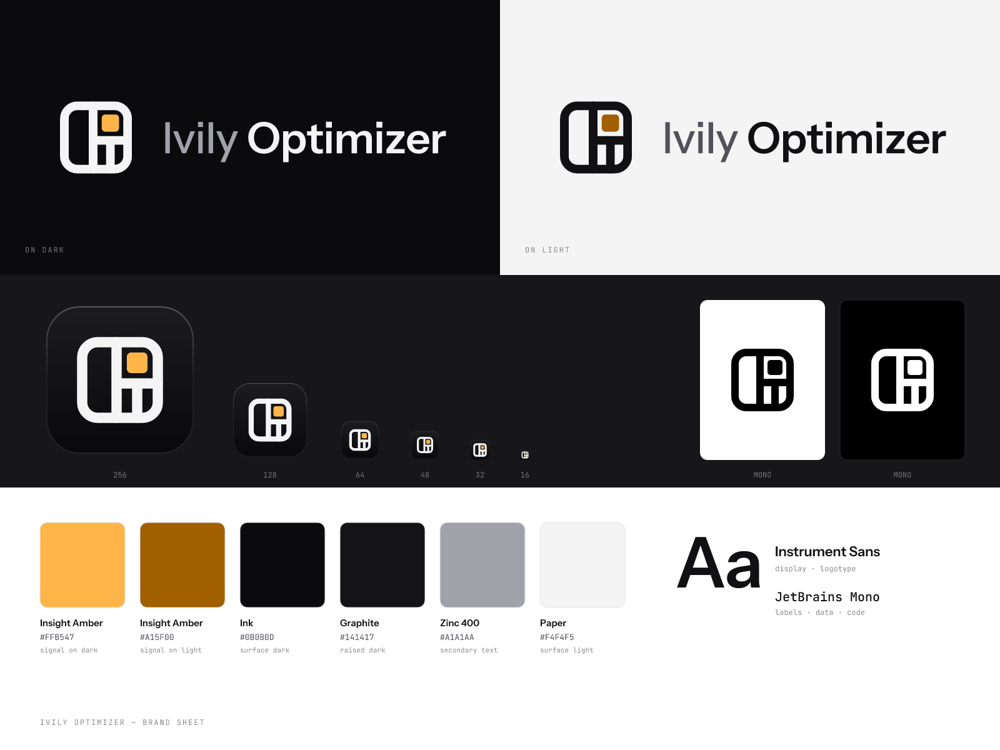

<p align="center">
  <picture>
    <source media="(prefers-color-scheme: dark)" srcset="logos/ivily-optimizer-horizontal-on-dark.svg">
    
  </picture>
</p>

# Ivily Optimizer — brand assets

Official logos, icons and visuals for Ivily Optimizer, part of the Ivily ecosystem.
The full brand guide (rationale, construction, colour, typography, usage rules) lives in the Ivily design workspace; this folder contains everything needed to use the brand from this repository.

<p align="center"></p>

## Identity in one paragraph

**Symbol — a treemap with one cell worth your attention.** The symbol is a **treemap** — the way Optimizer actually shows where storage goes. It represents measurement before action.

**Signal colour — Insight Amber:** `#FFB547` on dark, `#A15F00` on light. Insight Amber marks *items that deserve attention*: review-recommended cleanup items, findings, growth hot spots. Optimizer’s in-app design system remains monochrome; amber is for brand, marketing and icons first, and enters the UI only by explicit design decision.

## Contents

| Path | What | Use |
|---|---|---|
| `logos/ivily-optimizer-horizontal-*.svg` | **Primary logo** (symbol + "Ivily Optimizer") | READMEs, websites, documents |
| `logos/ivily-optimizer-vertical-*.svg` | Stacked logo | Splash screens, square placements |
| `logos/ivily-optimizer-logotype-*.svg` | Name only | Next to an existing symbol |
| `logos/ivily-optimizer-symbol-*.svg` | Symbol only | Title bars, favicons, tight spaces |
| `logos/png/` | Transparent PNG renders | Where SVG is not accepted |
| `icons/ivily-optimizer-app-icon.svg` | Application icon master (1024) | Source for every icon size |
| `icons/ivily-optimizer-app-icon-small.svg` | Optical variant for 16–32 px | Small icon sizes |
| `icons/ivily-optimizer-app-icon-light.svg` | Light container variant | Light marketing contexts |
| `icons/png/` | App icon PNG 16 → 1024 | Stores, websites, docs |
| `icons/ivily-optimizer.ico` | Windows icon (16, 24, 32, 48, 64, 128, 256) | Installer, shortcuts |
| `icons/tauri/` | Drop-in set with `src-tauri/icons/` file names | Adopting the icon in the app |
| `banners/ivily-optimizer-readme-banner-{dark,light}.svg` | README header, 1600 × 560 | This repository's README |
| `banners/ivily-optimizer-social-preview.png` | 1280 × 640 | GitHub → Settings → Social preview |
| `illustrations/ivily-optimizer-product-visual-*.{svg,png}` | Product visual — **illustration, not a screenshot** | Storytelling, docs |
| `patterns/ivily-optimizer-pattern-tile-*.svg` | Seamless tile | Backgrounds at 4–8 % opacity |
| `ecosystem/` | Ivily parent mark, ecosystem lineup and diagram | "Part of Ivily" sections |
| `palette.json`, `tokens.css` | Colour and type tokens | Web pages, future UI work |

Colourway suffixes: `-on-dark`, `-on-light`, `-mono-white`, `-mono-black`.

## Using the logo in Markdown

```html
<picture>
  <source media="(prefers-color-scheme: dark)" srcset="assets/brand/logos/ivily-optimizer-horizontal-on-dark.svg">
  
</picture>
```

## Adopting the new application icon

The application currently ships its existing icon (`src-tauri/icons/`, generated from `src/lib/brand.js`) and its in-app logo is unchanged. Switching is a deliberate product decision. When ready:

```powershell
Copy-Item assets/brand/icons/tauri/* src-tauri/icons/ -Force
# or regenerate every platform size from the master:
npx tauri icon assets/brand/icons/ivily-optimizer-app-icon.svg -o src-tauri/icons
```

Then rebuild and check the taskbar, installer and Start-menu icons at 100 % and 150 % scaling.

## Rules

- Keep clear space of ¼ of the symbol height around every logo. Minimum symbol size 16 px.
- Use the colourway that matches the background; never recolour, outline, add effects, rotate or stretch.
- Only Insight Amber may appear as a colour in Ivily Optimizer brand materials.
- Product visuals are illustrations and must be labelled as such.

## Other files in this folder

- `ivily-*.svg`, `app-icon.svg`, `github-banner.svg` — generated by `scripts/brand.mjs` from `src/lib/brand.js` (the cat mark). Still used by the app build and `docs/MARKA.md`; not managed by the design workspace.

---

<sub>Generated from the Ivily design workspace. Typefaces in logos: Instrument Sans and JetBrains Mono (SIL Open Font License 1.1), converted to outlines.</sub>
